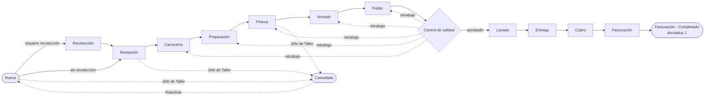

# Taller — Flujo Hojalatería y Pintura (Frappe)

App de Frappe (v14/v15) con el DocType **Orden Taller**, el workflow
**Flujo Hojalatería y Pintura** y un motor de **reglas de transición** configurable desde el Desk.

## Instalación

```bash
cd frappe-bench
bench get-app /ruta/a/taller        # o la URL de tu repo
bench --site <sitio> install-app taller
```

`after_install` crea: 13 roles, 37 Workflow States, 21 acciones, permisos, el workflow
(140 transiciones) y 10 reglas de ejemplo.

## Tipo de orden

Cada orden es de **Hojalatería y Pintura** (predeterminado) o **Mecánica**, y cada tipo tiene
su secuencia de pasos (`FLUJOS_POR_ORDEN` en `taller/flujo/configuracion.py`):

| Hojalatería y Pintura | Mecánica |
|---|---|
| Recolección (opcional) | — |
| **Recepción** | **Recepción** |
| Carrocería, Preparación, Pintura, Armado, Pulido | Diagnóstico, Cotización, Autorización del cliente, Refacciones, Reparación, Hallazgo adicional |
| Control de calidad (retrabajo a Carrocería…Pulido) | Control de calidad y ruta (retrabajo a Reparación) |
| **Lavado, Entrega, Cobro, Facturación** | **Lavado, Entrega, Cobro, Facturación** |

Los pasos con el mismo nombre (en negritas) son el mismo paso: comparten estados del
workflow y reglas (vehículo en Recepción, entrega, cobro y facturación). Frappe permite un solo
workflow por DocType, así que las transiciones llevan la condición del tipo de orden que las usa
(`doc.tipo_orden == ...`, o `in (...)` en los pasos compartidos); Cancelar y Reactivar aplican a
cualquier tipo. El tipo de orden solo se cambia mientras la orden está en *Nueva*.

La valuación (Audatex o captura manual) es de Hojalatería y Pintura. En Mecánica:

| Paso | Para completarlo |
|---|---|
| Diagnóstico | Capturar el diagnóstico |
| Cotización | Crear la cotización (Crear → Cotización) |
| Autorización del cliente | Presupuesto aprobado (se marca al enviar la orden de venta) |
| Hallazgo adicional | Describirlo y agregar el trabajo a la orden de venta con *Actualizar artículos*; si no hubo, se anula |
| Control de calidad y ruta | Checklist de calidad aprobado |

Cotización, orden de venta, factura, cobro, consumo de materiales, timesheets y costeo funcionan
igual en los dos tipos. Las reglas tienen un campo *Tipo de orden* para limitar su alcance.

## Estatus de la orden

Cada orden tiene un **Estatus** del catálogo **Estatus Orden Taller**: Activo (verde),
Inactivo (gris), Cancelado (rojo) y Terminado (azul). Los cuatro son de sistema: no se pueden
borrar. Se pueden agregar más estatus con su color.

- Toda orden nace **Activa**.
- El workflow lo actualiza al **Cancelar** (Cancelado), al completar el **último paso**
  (Terminado) y al **Reactivar** (Activo). Fuera de esas transiciones se respeta el estatus
  capturado a mano.
- Se cambia desde el formulario (también en órdenes terminadas) o en bloque desde la lista
  (*Acciones → Editar*). La lista lo muestra con su color y lo tiene en la barra de filtros;
  el reporte de rentabilidad también lo filtra.
- Cuando no es Activo, el encabezado del formulario muestra el estatus con su color.

## Pasos y estados

Cada paso entra **En Proceso** y sale **Completado** o **Anulado** (paso omitido); desde
cualquiera de los dos la orden avanza al siguiente paso. El último paso (Facturación) no se
puede anular.



| Paso | Rol responsable |
|---|---|
| Recolección | Chofer |
| Recepción, Entrega | Asesor de Servicio |
| Carrocería | Hojalatero |
| Preparación | Preparador |
| Pintura | Pintor |
| Armado | Armador |
| Pulido | Pulidor |
| Control de calidad | Inspector de Calidad |
| Lavado | Lavador |
| Cobro | Cajero |
| Facturación | Facturista |

`Jefe de Taller` puede ejecutar cualquier transición y es el único que cancela.
El campo `paso_actual` se actualiza solo, para filtrar la lista por paso.

## Flujo de la orden y tabla de pasos

La sección **Flujo de la orden** muestra una tarjeta por paso (número, nombre y estado) y la
tabla **Pasos** (DocType hijo `Paso Orden Taller`) con Paso, Estado, Usuario, Fecha y hora,
Hrs est. y Hrs reales. El servidor la mantiene en `taller/flujo/pasos.py` a partir del
workflow; solo las horas estimadas son editables (sus valores por defecto están en
`HORAS_ESTIMADAS`).

- Al entrar a un paso su fila queda En Proceso; los pasos anteriores sin tocar (Recolección
  cuando no se requiere) quedan Anulados.
- Las horas reales suman el tiempo que el paso estuvo En Proceso, incluyendo retrabajos.
- Un retrabajo desde Control de calidad limpia los pasos posteriores al paso destino.
- Cancelar anula el paso en curso; Reactivar limpia los estados y conserva las horas.

## Tipos de flujo: Agencia, Particular, Aseguradora

Frappe permite **un solo workflow activo por DocType**, así que los tres tipos comparten
workflow y se distinguen con el campo `tipo_flujo`. Cada tipo tiene su secuencia en
`taller/flujo/configuracion.py → FLUJOS`. Hoy los tres usan los 12 pasos; si cambias una
secuencia (por ejemplo, quitar Recolección para Agencias), el generador agrega
automáticamente `doc.tipo_flujo == "..."` en las transiciones que dejan de ser comunes.

Restricción de Frappe que el generador valida: el último paso de cada tipo termina en
docstatus 1 (enviado), y un documento enviado no puede volver a borrador. Por eso todos los
tipos deben terminar en el mismo paso (hoy, Facturación).

Después de editar la configuración:

```bash
bench --site <sitio> execute taller.flujo.configuracion.instalar --kwargs "{'reconstruir': True}"
```

La reconstrucción **conserva las condiciones** que hayas escrito a mano en las transiciones.

## Valuación (Audatex o captura manual)

Cada orden necesita una **Valuacion Taller** aprobada (enviada) para completar **Recepción**
(regla "Recepción: valuación aprobada"). Se crea desde **Crear → Valuación** en la orden.

- **Agencia / Aseguradora**: adjunta el *Reporte Completo* de Audatex (PDF). Se lee solo
  (`taller/valuacion/audatex.py`): expediente, vehículo, partidas y totales del documento.
  Solo se puede aprobar si las partidas cuadran con la *Suma total sin IVA* del PDF (±$1).
- **Particular**: la misma forma, con las partidas capturadas a mano.

Partidas: Refacción, Mano de obra hojalatería / pintura (cantidad en horas = UT ÷ UT por
hora), Material de pintura / reparación y Otro, con descuento por partida.

Al aprobarla, la orden recibe el vehículo (lo crea si no existe), en Aseguradora el
siniestro, la póliza, la autorización y el monto autorizado, y las partidas pasan a los
**conceptos** (artículos `MO-HOJ`, `MO-PINT`, `VAL-REF`, `VAL-MATP`, `VAL-MATR`, `VAL-OTRO`) si aún
no hay orden de venta. Solo puede haber una valuación vigente por orden; para cambiarla se
cancela y se modifica (*amend*).

## VIN: dígito verificador y prellenado

En **Vehiculo Taller**, **Orden Taller** y **Valuacion Taller** el VIN se normaliza
(mayúsculas, sin espacios ni guiones) y se revisa al capturarlo
(`taller/vehiculo/vin.py` y `taller/public/js/vin.js`):

- **Formato**: 17 caracteres sin I, O ni Q; si no se cumple, se bloquea.
- **Dígito verificador** (posición 9): se bloquea en VINs de Norteamérica (empiezan con
  1-5; México es 3), donde es obligatorio. En otros orígenes solo se advierte, porque muchos
  fabricantes no lo usan. El VIN que viene de Audatex nunca bloquea, solo advierte.
- **Prellenado** con [ultravin](https://github.com/blackthorn-interstellar/ultravin) (base
  vPIC de la NHTSA embebida, sin red): marca, modelo y año, y en el Vehículo versión,
  carrocería y país de fabricación. Solo llena campos vacíos. La marca queda en mayúsculas.
- **Marca distinta al VIN**: si la marca capturada no coincide con la del VIN se advierte.

Solo se valida cuando el VIN es nuevo o cambia, así que los registros existentes no se bloquean.

## Contabilidad: clientes, facturas y cobros (ERPNext)

La orden no lleva contabilidad propia: genera y sigue los documentos estándar de ERPNext,
que hacen los asientos (`taller/erp/documentos.py`). Cliente y aseguradora son
**Customer** (grupos Particular, Agencia, Aseguradora) y el vehículo es un **Vehiculo Taller**.

Desde el botón **Crear** de la orden:

| Botón | Documento | Notas |
|---|---|---|
| Cotización | Quotation | Al pagador, con los conceptos de la orden |
| Orden de venta | Sales Order | Desde la cotización si está enviada; al enviarla marca *Presupuesto aprobado* |
| Cobro | Payment Entry | Anticipo contra la orden de venta, o pago contra la factura |
| Factura | Sales Invoice | Aplica anticipos; descarga inventario si hay materiales |

Quién paga: **Particular** → cliente; **Agencia** → el cliente, que es la agencia (el dueño
del vehículo queda en el Vehículo); **Aseguradora** → dos órdenes de
venta y dos facturas: la aseguradora (conceptos menos el deducible) y el cliente (artículo
`DEDUCIBLE`). El deducible se captura con IVA.

Total, cobrado, saldo, facturas y *Facturado* se recalculan solos al enviar o cancelar esos
documentos. Las reglas usan esos campos: Cobro pide saldo en cero y Facturación pide las
facturas enviadas.

### Costeo (fase 2)

Cada orden crea un **Project** (centro de costo *Taller*) y todo lo que genera lleva ese
proyecto: cotización, orden de venta, factura, pagos, consumos y horas
(`taller/erp/costeo.py`). La sección **Costeo** de la orden y el reporte
**Rentabilidad Orden Taller** muestran:

| Concepto | De dónde sale |
|---|---|
| Ingresos | Facturas enviadas de la orden, sin IVA |
| Materiales | Salidas de inventario con el proyecto: materiales facturados y consumibles (**Crear → Consumo de materiales**) |
| Mano de obra | Un Timesheet por cada tramo En Proceso de un paso, con el costo por hora de `Taller - <paso>` (Activity Type) o del empleado (Activity Cost) |
| Margen | Ingresos − materiales − mano de obra |

El Timesheet se liga al empleado cuyo usuario hizo el cambio (Employee → Usuario). El
proyecto pasa a *Completed* al cerrar la orden y a *Cancelled* si se cancela.

### Configuración de la compañía (fase 0)

`taller/erp/configuracion_empresa.py` deja la compañía lista: cuentas por defecto, banco,
formas de pago, IVA por defecto, centro de costo y almacén del taller, grupos de cliente y un
catálogo básico de servicios y materiales con precios de referencia. Es idempotente:

```bash
bench --site <sitio> execute taller.erp.configuracion_empresa.configurar --kwargs "{'company': 'StarExpress'}"
```

Las cuentas están en `CUENTAS` (sin el sufijo de la compañía); revísalas con tu contador.

## Agregar reglas de transición

### Opción 1 — Regla Transicion Taller (recomendada, sin despliegue)

En el Desk: **Regla Transicion Taller → Nuevo**.

| Campo | Uso |
|---|---|
| Tipo de flujo | Todos / Agencia / Particular / Aseguradora |
| Paso | Aplica al entrar a cualquier estado de ese paso |
| Estado origen / destino | Opcionales; el destino tiene prioridad sobre Paso |
| Condición | Expresión Python que **debe ser verdadera** |
| Si no se cumple | **Bloquear** (frena la transición) o **Advertir** (solo avisa) |

Variables disponibles: `doc`, `anterior`, `origen`, `destino`, más los globals seguros de
Frappe (`frappe.db.get_value`, `frappe.utils`, …). Ejemplos:

```python
doc.numero_siniestro and doc.autorizacion_aseguradora
doc.saldo_pendiente <= 0 or doc.forma_pago == "Crédito"
frappe.utils.date_diff(frappe.utils.today(), doc.fecha_ingreso) < 30
```

Si varias reglas bloquean, se muestran todos los mensajes juntos.

### Opción 2 — Condición nativa de la transición

En **Workflow → Flujo Hojalatería y Pintura → Transitions → Condition**. Aquí la condición
oculta el botón en lugar de mostrar un mensaje; útil para acciones que no deben ni aparecer.

## Estructura

```
taller/
├── hooks.py
├── erp/
│   ├── configuracion_empresa.py  # fase 0: compañía, cuentas, catálogo, costos por hora
│   ├── costeo.py                 # fase 2: proyecto, timesheets, consumos, margen
│   └── documentos.py             # cotización, orden de venta, factura, cobro
├── vehiculo/
│   └── vin.py                    # dígito verificador y prellenado con ultravin
├── valuacion/
│   └── audatex.py                # lector del PDF de Audatex
├── flujo/
│   ├── configuracion.py   # pasos, estados, FLUJOS por tipo, generador e instalación
│   ├── pasos.py           # tabla de pasos y horas reales
│   └── reglas.py          # motor de reglas de transición
└── taller/doctype/
    ├── orden_taller/
    ├── paso_orden_taller/
    ├── valuacion_taller/
    └── regla_transicion_taller/
```

Requiere ERPNext (Customer, Item, Quotation, Sales Order, Sales Invoice, Payment Entry).

## Regresión

`taller/tests/regresion.py` prueba de punta a punta sobre el sitio (tipo de orden,
workflow, valuación, VIN, contabilidad de los tres tipos de flujo y costeo). Cada caso se
revierte, así que no deja datos:

```bash
bench --site <sitio> execute taller.tests.regresion.correr --kwargs "{'pdf': '/ruta/VALUACION.pdf'}"
```

Sin `pdf` se omite el caso del PDF de Audatex.
